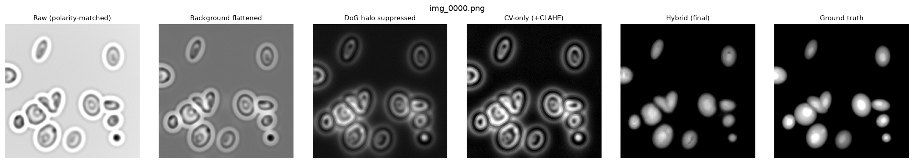
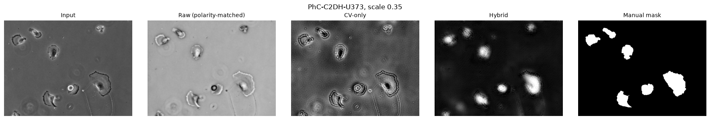

# Phase-Contrast Microscopy Clean-Up Pipeline

[](https://github.com/akshayaa-403/phase-contrast-denoising/actions/workflows/ci.yml)
[](LICENSE)

Phase-contrast microscopes draw a bright **halo** around every cell and fade the
middle of large cells back towards the background (**shade-off**); on top of
that, illumination is rarely even across the field. All three break the
simplest and most common analysis step: a single global threshold to find the
cells. This project removes them, with a toggle between two paths:

- **`cv_only`**: classical image processing only (OpenCV). Polarity flip,
  background flattening, Difference-of-Gaussians halo suppression, CLAHE,
  percentile normalisation. Milliseconds on a CPU, no model, every step
  inspectable.
- **`hybrid`**: the same classical front-end, then a residual U-Net that
  predicts what is still wrong and subtracts it (`cleaned = input - residual`).

## Results

**Synthetic test set** (30 images from a separate seed, never used for
training or for tuning any parameter). Mean with 95% bootstrap CI. Full table,
including generic denoisers, in `results/report.md` (regenerate with the
command under Quick start).

| Path | PSNR (dB) | SSIM | Otsu Dice |
| :--- | ---: | ---: | ---: |
| Raw input (polarity-matched) | 1.46 [1.22, 1.71] | -0.02 | 0.081 [0.070, 0.092] |
| Best generic denoiser (Gaussian / median / NL-means) | 1.48 | -0.02 | 0.081 |
| CV-only | 15.05 [14.53, 15.62] | 0.085 | 0.566 [0.545, 0.588] |
| **Hybrid (CV + residual U-Net, shipped)** | **28.65 [27.98, 29.27]** | **0.834** | **0.943 [0.937, 0.949]** |
| CV + plain U-Net (ablation) | 30.20 [29.31, 31.11] | 0.963 | 0.953 [0.948, 0.958] |

Raw PSNR is near 1 dB because the raw background is grey and the target's is
black; affine-matched PSNR (see *Reading the metrics*) puts raw at 17.5 dB,
CV-only at 18.8 dB and the hybrid at 29.7 dB.



What the numbers say:

- **Halos and uneven illumination, not noise, are what break segmentation.**
  Generic denoisers leave Otsu Dice at 0.08. The classical path, mainly its
  background-flattening step, lifts it to 0.57; the U-Net to 0.94.
- **Residual learning did not win here.** With the same network, data and
  training budget, predicting the image directly beat predicting the residual
  by 1.6 dB PSNR and 0.010 Dice, and the confidence intervals do not overlap.
  The shipped model stays residual because that is the design this project
  set out to evaluate, and the ablation is reported rather than hidden.
- **Real data** ([Cell Tracking Challenge](https://celltrackingchallenge.net)
  PhC-C2DH-U373, 34 frames with manual segmentations; `results_real/report_real.md`):

  | Path | Otsu Dice, native resolution | Otsu Dice, rescaled 0.35 (chosen in advance) |
  | :--- | ---: | ---: |
  | Raw | 0.099 [0.089, 0.109] | 0.095 [0.086, 0.105] |
  | CV-only | **0.607 [0.582, 0.630]** | 0.353 [0.322, 0.381] |
  | Hybrid | 0.601 [0.580, 0.622] | **0.634 [0.609, 0.658]** |

  The classical path transfers to real cells as-is (0.10 -> 0.61). The U-Net,
  trained only on synthetic cells, helps only once frames are rescaled so
  cells match the training size, and then by a little: it finds the cells but
  draws them as the smooth domes it was trained on. Real training data would
  be the next step; see [MODEL_CARD.md](MODEL_CARD.md).

  

- **Cost** (512 x 512, this CPU, idle, median of 10 after warm-up; `scripts/benchmark.py`):
  CV-only **16 ms** (budget 50 ms: met); hybrid 456 ms on CPU. The hybrid budget
  (< 300 ms, < 2 GB VRAM on a T4) has not been measured, because no GPU was
  available; run `python scripts/benchmark.py` on one. The U-Net is 7.8 M
  parameters and ~109 GFLOPs per 512 x 512 image, about 700x the classical path.

## Quick start

Python 3.10+. CPU works; CUDA is used automatically if present.

```bash
pip install -r requirements.txt            # or: pip install -e .[dev,demo]
python scripts/download_weights.py         # pre-trained model -> models/ (SHA-256 checked)
python data/generate_synthetic.py          # 100 train/val pairs + 30 test pairs
```

Hybrid inference on the held-out test set (writes cleaned images and `report.md`):

```bash
python main.py --input_dir data/test/noisy_input --clean_dir data/test/ground_truth \
               --output_dir results --mode hybrid
```

CV-only (no model needed):

```bash
python main.py --input_dir data/test/noisy_input --clean_dir data/test/ground_truth \
               --output_dir results_cv --mode cv_only
```

Your own images (no ground truth: the report shows samples and cost only).
PNG, JPG and TIFF, 8- or 16-bit, including compressed and multi-page TIFF; any
size (images are padded for the U-Net and tiled above 1024 px). 16-bit inputs
are written back as 16-bit.

```bash
python main.py --input_dir data/raw --output_dir results_real --mode hybrid
```

Real-data evaluation (downloads ~43 MB from the Cell Tracking Challenge):

```bash
python scripts/eval_real_data.py --download
```

Interactive demo (Gradio): `pip install gradio && python app.py`.

## Training

```bash
python main.py --train --data_dir data                   # writes runs/best.pth, runs/last.pth
python main.py --train --data_dir data --resume          # continue from runs/last.pth
python main.py --train --data_dir data --plain_unet --runs_dir runs_plain   # ablation
tensorboard --logdir runs
```

AdamW (lr 1e-4, weight decay 1e-5), L1 loss on the residual, ReduceLROnPlateau
on validation PSNR, early stopping, mixed precision on CUDA. TensorBoard logs
train/val loss, val PSNR, learning rate and an input / residual / output /
target image grid. Every checkpoint stores the model and preprocessing settings
it was trained with plus the git commit; loading it under different
preprocessing logs a warning, because the U-Net only knows the inputs it was
trained on.

To publish a new model: `python scripts/compress_checkpoint.py` (fp16, prints
the SHA-256), `python scripts/export_onnx.py`, attach both files to a GitHub
release, and update the hashes in `scripts/download_weights.py` and
`.github/workflows/pages.yml`.

## How it works

### The data: a physical model, not a guess

Real phase-contrast images have no artifact-free twin, so the U-Net trains on
synthetic pairs. `data/generate_synthetic.py` follows the imaging model of
Yin, Kanade & Chen (*Medical Image Analysis* 2012):

```
g = C - beta * (f - k * f)
```

`f` is the cell's optical path difference (the target), `k` the phase ring's
point-spread function, an obscured Airy pattern, apodised. Both artifacts fall
out of that one equation: next to a cell `f = 0` but `k * f > 0`, so the
background brightens (halo); inside a large flat cell `k * f ≈ f`, so it fades
(shade-off). Cells appear dark on grey, as in positive phase contrast. Then a
camera: multiplicative uneven illumination and Poisson-Gaussian noise, saved as
16-bit PNG.

The first version of this project built its halo as a Difference of Gaussians,
the same operation the classical path removes it with, so its evaluation was
partly circular. This one is not, and the real-data check below tests whether
any of it transfers.

### The classical path, step by step

1. **Polarity.** Invert so cells are bright, as thresholding and the target expect.
2. **Flatten the background.** A grey-level opening with a square larger than
   any cell removes the cells and leaves the illumination; smooth it and
   subtract (ImageJ's rolling-ball idea). This is the step that rescues
   segmentation: a DoG responds to a linear brightness ramp with zero, so it
   cannot remove uneven illumination on its own.
3. **Suppress the halo.** Blur at two scales; their difference holds the halo
   band; subtract `alpha` times it.
4. **CLAHE.** Local contrast, 8-bit histograms so the clip limit actually works
   (with 65,536 bins OpenCV's per-bin ceiling is 1 for any tile under ~32k px,
   so clip does nothing; the old default had that bug).
5. **Normalise** by the 1st/99.8th percentiles, so one hot pixel cannot squash
   the image.

The defaults were tuned on the **validation** split (Otsu Dice of the CV
output); the test split was never used for tuning. Higher CLAHE clip limits
look punchier but lower Dice, so CLAHE is set mild (clip 1.0).

### Why predict the residual?

The network outputs what to *remove*, not a new image. Its output is close to
zero wherever the input is already right, so it cannot easily invent or erase
structure that the classical path preserved, and its errors stay small
corrections to an inspectable baseline. That is the argument; the report tests
it with an ablation (same network trained to output the image directly). See
the results above for whether this test set supports it.

### Reading the metrics

- **PSNR/SSIM** compare to the target pixel by pixel. Only a trained model can
  know the target's absolute grey levels, so plain PSNR heavily penalises the
  raw input and classical filters for a background offset. The report adds
  **affine-matched** PSNR/SSIM (fit `a·x + b` to the target first, as CARE /
  CSBDeep do), which is the fair comparison for non-learned methods.
- **Otsu Dice** is the downstream question: does a global threshold now find
  the cells? It is the headline metric.
- Every mean comes with a 95% bootstrap confidence interval.

## Browser demo (GitHub Pages)

`docs/` is a static page that runs the classical path live in your browser,
beside the U-Net's output, with no server and no install. Pick a held-out
sample or upload your own image (PNG, JPG or TIFF, 16-bit kept via
`docs/decode.js`; nothing leaves the tab), compare, move the sliders, and read
PSNR, SSIM and Otsu Dice against the ideal. Uploads have no ideal, so the page
shows edge sharpness and background unevenness instead, and can run the U-Net
itself through ONNX Runtime Web (a one-time ~31 MB download).

```bash
python scripts/make_demo_assets.py                       # writes docs/samples/
python scripts/export_onnx.py && mkdir -p docs/models && cp models/phase_unet.onnx docs/models/
python -m http.server -d docs 8000                       # preview
```

The Pages workflow publishes `docs/` and fetches the ONNX model from the
release (checksum-verified), so the model is never committed. Enable Pages once
under **Settings -> Pages -> Source: GitHub Actions**.

**Samples are the 20 frames the U-Net never trained on**: the validation split
that `phase_cleanup.dataset.split_pairs` defines, the same function the
trainer uses.

**Is the JavaScript port trustworthy?** `docs/cv.js` re-implements
`phase_cleanup/preprocessor.py`: OpenCV's Gaussian kernels and float32 filter
arithmetic, `BORDER_REFLECT_101`, the rectangular grey-level opening, CLAHE as
`clahe.cpp` computes it, and NumPy's percentile interpolation. It decodes images
to the same float32 values as `image_io.load_gray01`. On the 20 samples its
output is **bit-identical** to Python's at both CLAHE precisions, and its PSNR,
SSIM and Dice match exactly. Two checks keep it that way and run in CI:

```bash
python scripts/verify_web_pipeline.py   # JS vs Python output, PSNR/SSIM/Dice, both CLAHE precisions
node scripts/check_controls.js          # every slider changes the output (and 16-bit clip does not)
```

### Accessibility

- **Themes.** Light and dark, following the OS preference until you pick one.
- **Keyboard.** Skip link, landmarks and visible focus rings; every control is
  a native input.
- **Labels and tables.** Controls are labelled; tables have row and column headers.
- **Screen readers.** An `aria-live` status announces results.
- **Preferences.** `prefers-reduced-motion` and `prefers-contrast: more` are honoured.

## Tests and checks

```bash
pip install -r requirements-dev.txt
pytest                              # unit + integration tests
ruff check .
python scripts/benchmark.py         # latency / VRAM against the budget
```

CI (`.github/workflows/ci.yml`) runs lint, tests on Python 3.10 and 3.12, a
CPU smoke run of inference + report + one training epoch, and both web-demo
checks.

## Layout

```
configs/default_config.yaml     every CV + DL hyperparameter
data/generate_synthetic.py      physics-based paired data (train/val + test)
data/raw/                       drop your own images here
phase_cleanup/preprocessor.py   classical path (OpenCV only)
phase_cleanup/residual_unet.py  residual U-Net (+ plain variant for the ablation)
phase_cleanup/pipeline.py       cv_only / hybrid toggle, tiling, checkpoint checks
phase_cleanup/dataset.py        paired DataLoader + augmentations
phase_cleanup/trainer.py        training loop, early stopping, resume, TensorBoard
phase_cleanup/metrics.py        PSNR/SSIM (plain + affine), Dice, bootstrap CIs, FLOPs
phase_cleanup/report.py         report.md + figures
phase_cleanup/image_io.py       8/16-bit, TIFF-aware loading and saving
scripts/download_weights.py     fetch + verify the release model
scripts/compress_checkpoint.py  fp32 -> fp16 checkpoint
scripts/export_onnx.py          ONNX export (+ check against PyTorch)
scripts/eval_real_data.py       Cell Tracking Challenge U373 evaluation
scripts/benchmark.py            latency / VRAM budget check
scripts/make_demo_assets.py     docs/samples/ for the browser demo
scripts/verify_web_pipeline.py  docs/cv.js vs OpenCV
scripts/check_controls.js       every demo control moves the output
docs/                           the GitHub Pages demo (static)
tests/                          pytest suite
app.py                          Gradio demo
main.py                         CLI
MODEL_CARD.md                   what the model is, and is not, validated for
```

## License and citation

MIT (see [LICENSE](LICENSE)). Citation metadata is in
[CITATION.cff](CITATION.cff). The U373 data used for the real-data check
belongs to the Cell Tracking Challenge and is not redistributed here.
